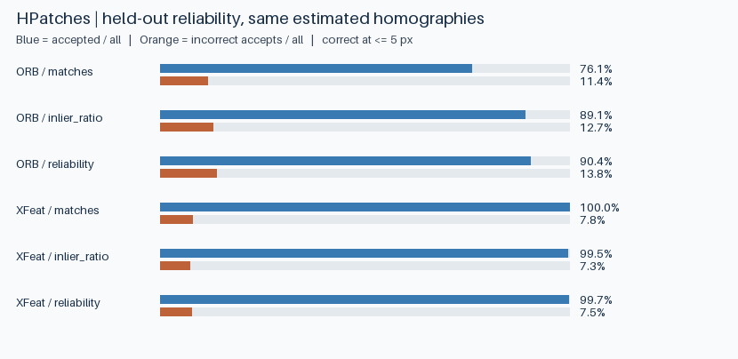

# Reliability-aware planar localization

Estimate a planar homography with XFeat or ORB, then decide whether to accept it. Both matchers use the same robust estimator. The formal experiment calibrates three acceptance rules on development scenes and evaluates their failure/coverage tradeoff on separate HPatches scenes.



On **77 held-out sequences (385 pairs)**, XFeat's combined rule accepted 384 estimates, including 29 with mean four-corner error above 5 px. Its median accepted error was 1.07 px. The XFeat inlier-only rule accepted 383 estimates with 28 incorrect accepts. ORB's combined rule accepted 348 estimates with 53 incorrect accepts. The combined rule's additional coverage came with extra mistakes at this development operating point. A failure on `v_calder` 1→6 passed all three XFeat rules despite a 722.20 px corner error.

[Held-out table](results/summary.csv) · [Worst accepted failures](results/false_accepts.json) · [Exact splits and measured environment](results/run.json) · [Generated poster and match lines](examples/demo.png)

With Python 3.11 and Git installed, run the following from a clean clone. CPU inference is intentional. Downloads use the repository-local `.cache/` unless you supply `--cache PATH`.

```shell
python -m venv .venv
# PowerShell: .\.venv\Scripts\Activate.ps1
# Bash: source .venv/bin/activate
python -m pip install -r requirements.txt
python run.py demo
```

## Reproduce and inspect

```shell
python -m unittest discover -s tests -v
python run.py reproduce --out work/full
python run.py evaluate --predictions work/full/predictions.jsonl --out work/rebuilt
```

The formal run fetches the pretrained XFeat code/checkpoint and verifies a 1.19 GiB archive of full images from HPatches. Interrupted dataset downloads can resume. It records each estimated homography, match count, inlier/coverage statistics, operating score and correctness measurement in JSON Lines. The evaluation step only needs Pillow and saved predictions. It rebuilds a CSV for all scenes and the separate illumination/viewpoint groups, a comparison plot, and the largest-error accepted pair for each rule when one exists. `python run.py evaluate` rebuilds these artifacts directly from the included prediction file.

## Evaluation protocol

- Use all 116 original sequences, pairs 1→2 through 1→6. Sort the illumination and viewpoint sequences separately and assign indices 0, 3, 6, … to development. All five pairs of a sequence belong to the same split.
- Resize with preserved aspect ratio, longest side at most 480 px. Transform the ground-truth homography to resized pixel-center coordinates. ORB and XFeat use at most 1,024 features, mutual matches and the same OpenCV USAC_MAGSAC estimator.
- The first two rules threshold raw match count and inlier fraction. The combined rule multiplies inlier fraction, the smaller of the source/target 4×4 occupied-inlier grid fractions, and a penalty based on median inlier reprojection error. For each method and rule choose the lowest development threshold reaching 90% precision, equivalent to the highest coverage among eligible tied-score thresholds. If no threshold qualifies, reject all.
- A localization is correct at mean four-corner error ≤5 pixels at the evaluation resolution. Coverage and false-accept fraction both use all held-out pairs as the denominator; accepted risk uses accepted pairs only. Failed estimation counts toward total pairs and is rejected. Ground truth is used to choose operating points on development and to score predictions on test.
- Most pairs contain a real shared plane. This benchmark measures incorrect geometry on positive pairs. It does not estimate the false-positive rate in an open-world collection of unrelated images.

## Project layout

| Path | Purpose |
| --- | --- |
| `configs/benchmark.json` | Frozen model/data hashes and evaluation settings |
| `src/assets.py` | Pinned code, checkpoint and data acquisition |
| `src/experiment.py`, `src/geometry.py` | Extraction, matching, estimator and geometric measurements |
| `src/evaluate.py` | Calibration, held-out summaries and chart generation |
| `examples/`, `results/` | Demonstration and formal run artifacts |

See [UPSTREAM.md](UPSTREAM.md) for attribution and [HANDOFF.md](HANDOFF.md) for the latest run state.
